# Assembly

One bay and one caddy per drive. Every part prints flat with no support; see
the parts table in the [README](../README.md). Glue is never required: the
wall tabs are dovetails that snap into notches at the plates' edges, and
the rear panel's tabs are friction fits.

Colours in the pictures: plates blue, walls green, rear panel purple, caddy
tray orange, bezel brown, drive grey.

## Bay

### 1. Rear panel into the bottom plate

Take the plate with **two** slots, bumps down, slots at the rear. Stand the
rear panel in it, low groove on the outside and the open corner at the
bottom, on the same side as the drive's SATA connector: on the left, seen
from behind. Its two bottom tabs drop into the slots.

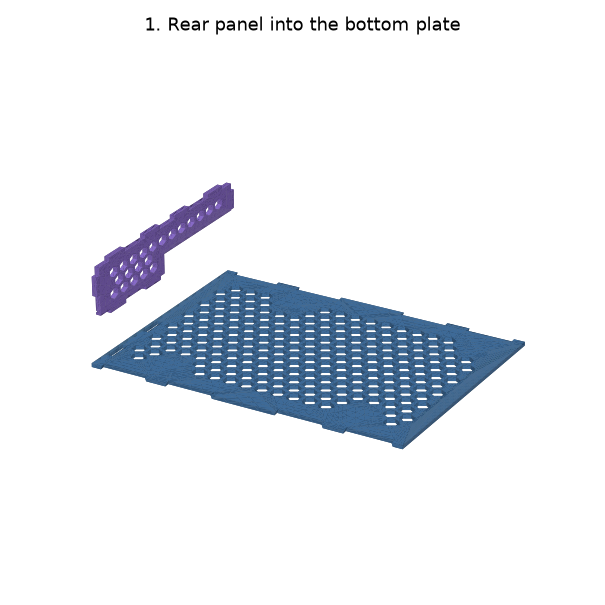

### 2. Top plate on

Take the plate with **six** slots, bumps up, the row of four at the rear.
Lower it onto the panel's four top tabs. It caps the panel's side edges.
The plates are held only at the rear for now: keep their front ends apart
by hand, about a wall's height, for the next step.

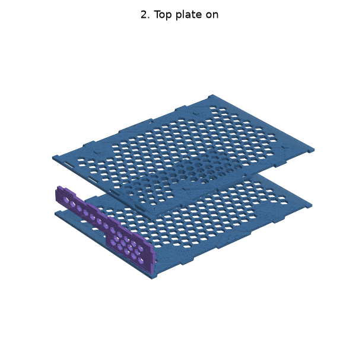

### 3. Walls in from the sides

Slide each wall in sideways, low groove on the outside and near the floor.
Either end of a wall may face the rear. Its four top and four bottom tabs
go into the notches at the plates' edges, and its slot goes onto the
panel's side tab, all at once. It is a tight slide, and near the end the
tabs pass a very slight narrowing at the notches' mouths. The wall is then
locked: its tabs widen toward the plates' outer faces, so it cannot lift
out, and slightly toward its inner face, so it does not slide back out.
The corners of the notches and of the tab roots are relieved, so they need
no cleaning out. If a wall still will not go in by hand, clean the
notches' sloped ends and the tab ends of elephant foot and stringing,
then try again. To take a wall off, push it out
sideways from the inside, evenly along its length.

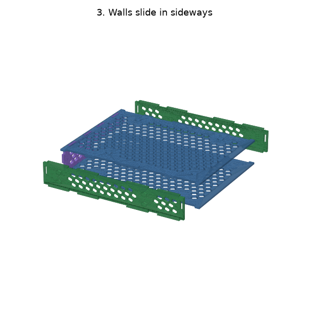

## Caddy

### 4. Bezel onto the tray

Press the bezel onto the tray's five front tabs, two on each wall and the
long one on the floor, with the lip at the top. The wall tabs flare out
slightly and the floor tab's ledge has a small barb: press until the bezel
clicks over all of them. It then stays on; to take it off again, push the
wall tabs in from the outside and lift the bottom slot's edge over the barb
with a small screwdriver.

To make it permanent, run a drop of thin superglue into the small round
holes at two corners of each upper wall-tab slot. The walls' rear-panel
slots have the same holes, for the rear panel.

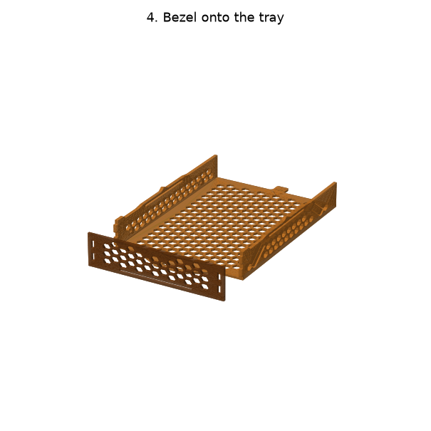

### 5. Drive into the caddy

Connector end to the rear. Tilt the drive onto the two fixed pins on the
wall without fingers, then press the other edge down: the two fingers flex
out and their pins snap into the drive's side holes.

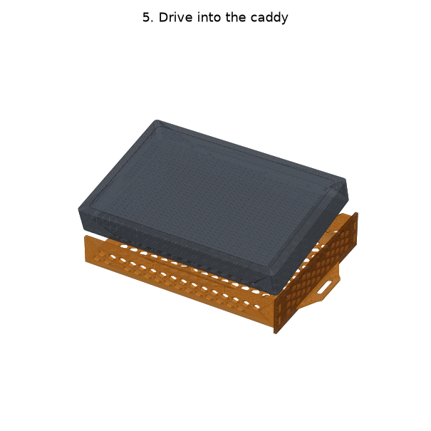

To take a drive out, put a small flat screwdriver into the hex hole at the
low end of each finger, against the finger's tip, and pry the tip outward
until its pin leaves the drive's hole. Then lift that edge of the drive.

## Into the bay

### 6. Slide the caddy in

Rear first. The spring bumps on top of the caddy walls ride under the top
plate and click into its two small slots as the bezel meets the bay.

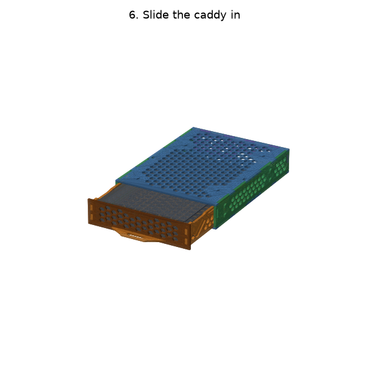

### 7. Seated, and how to get it out

Seated, the springs hold the caddy down and the bezel tight against the
bay. To remove it, hook a fingernail or fingertip into the slot in the
ledge that stands out under the bezel and pull, or push the tab that
sticks out of the rear panel's open corner from behind.

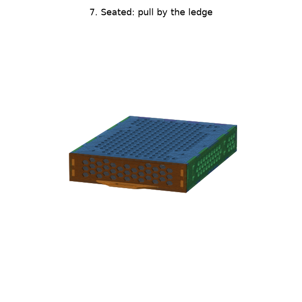

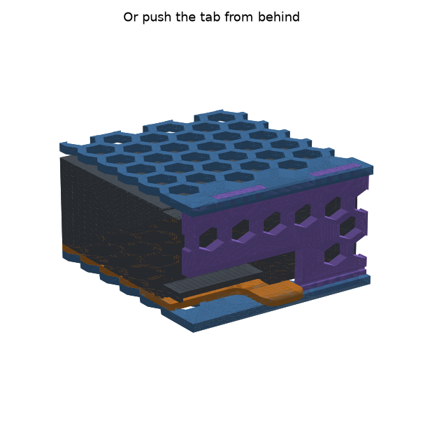

## Joining bays

Set the next bay on top, or bring it in from the side, facing the same way.
The bumps drop into the neighbour's honeycomb cells; no extra parts. Bumps
locate, they do not lock: glue them if a block must lift as one.

## Accessories

### 2.5" drive in an adapter

The adapter takes the place of a 3.5" drive in an ordinary caddy. Hang the
2.5" drive on the two pins of the adapter's long rail, connector end to the
rear, then press its other side down until the thin strip's pin snaps into
the drive's side hole. Put the adapter into the caddy like a 3.5" drive:
the rail side onto the fixed pins first, then press the strip side down
past the fingers. The drive's SATA connector comes out of the rear panel's
open corner where a 3.5" drive's would.

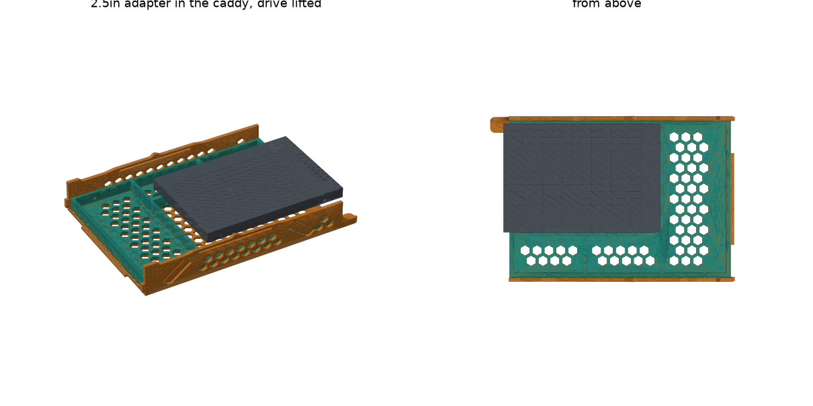

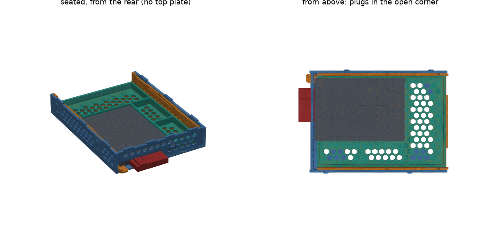

### Feet

Press four feet into the bottom plate of the lowest bays, near the
corners. Each foot's three pins go into three neighbouring open cells: two
in one row, one in the next row between them.

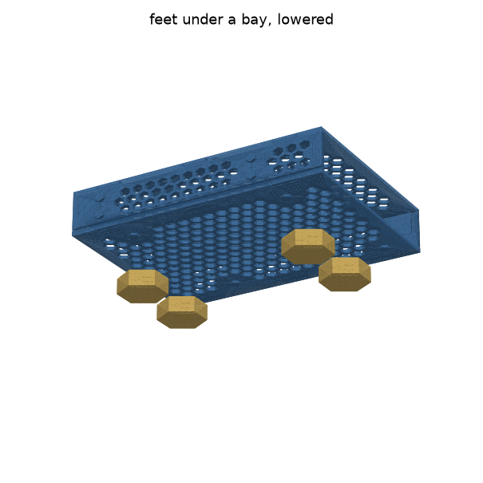

### Joiner plates

Lay a joiner on a bay's top plate, or against its side wall, and set the
next bay on it, facing the same way. The bumps of both bays drop into the
joiner's holes. Slide pieces together along their dovetails before laying
them. Over two columns or rows, use 0.5 + 1 + 0.5, so the seams fall at
mid-bay and tie the bays together; on a single bay, use 0.5 + 0.5, the
second half turned round. For four rows side by side, 0.5 + 3 + 0.5.
Use joiners in one direction per block: between
layers, with the columns touching, or between columns, with the layers
touching.

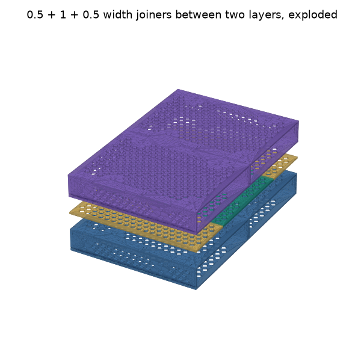

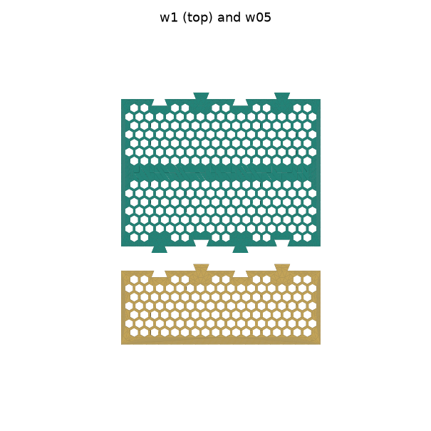

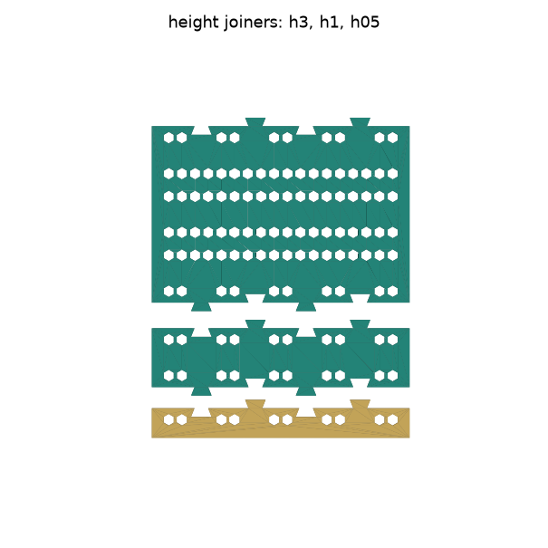
